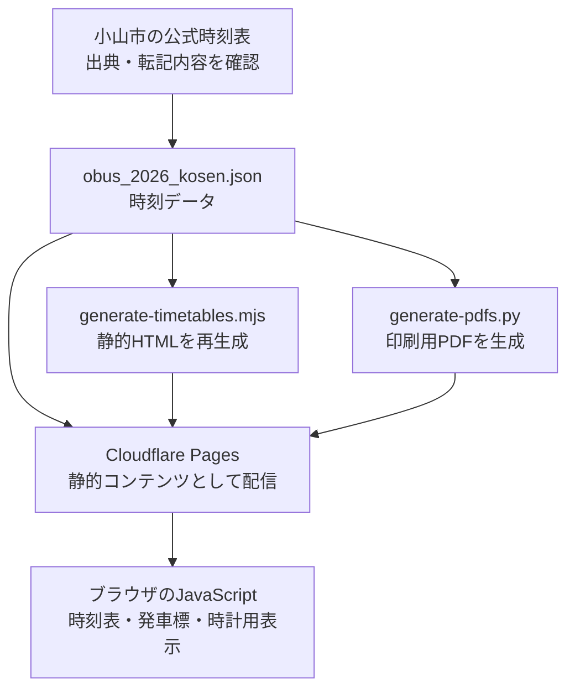

# サイトの仕組み

[← ドキュメント一覧（README）](../README.md) · [時刻表の更新・公開手順](maintenance.md)

## ひと目で分かる構成

**静的サイト**です。画面用のHTML・CSS・JavaScriptと、時刻データのJSONをCloudflare Pagesで配信する構成で、アプリケーションサーバーやデータベースはありません。

JSONを変更しただけでは、**生成済みHTMLとPDFは自動的に同じ内容になるとは限りません**。それぞれの再生成を確認してください。

## ページとコードの対応

| ファイル・ディレクトリ | 役割 |
| --- | --- |
| `index.html` | 入口。行き・帰りとPDFへの導線 |
| `obus_2026_kosen_s2k.html` / `..._k2s.html` | 方向別の時刻表。生成された静的時刻表も含む |
| `obus_2026_kosen.json` | 方向別の便、路線、停留所、運行条件、出典など |
| `assets/js/timetable.js` | 時刻表画面でJSONを読み込んで表示 |
| `departure/` と `assets/js/departure.js` | 発車標形式。次の**5便**を案内 |
| `watch/` と `assets/js/watch.js` | 時計などの小画面向け。次の**3便**を案内 |
| `assets/css/` | 各画面のデザイン |
| `scripts/generate-timetables.mjs` | JSONからHTMLの時刻表・凡例を再生成 |
| `scripts/generate-pdfs.py` | JSONから往復のA4印刷用PDFを生成 |
| `.github/workflows/build-pdfs.yml` | 条件付きでPDFの生成・検査・コミットを実行 |
| `_headers` | Cloudflare Pagesのレスポンスヘッダー・基本的な保護設定 |
| `robots.txt`, `sitemap.xml`, `404.html` | 検索エンジンへの案内と404ページ |
| `assets/js/migration-notice.js` | 旧URL経由の移転案内ダイアログ |

**S2K** は Station to Kosen（駅→高専）、**K2S** は Kosen to Station（高専→駅）の略です。公開時のHTML名・PDF名は互換性のため維持しています。

## データの読み方

原本 `obus_2026_kosen.json` の主な内容は以下のとおりです。

| キー | 意味 |
| --- | --- |
| `effective_from` | このデータが対象とする改正日（2026-10-01） |
| `sources` | 小山市公式資料のURLや資料名など |
| `routes` | 路線名・系統番号・出典の対応 |
| `stops` | 高専側の停留所・徒歩補正時分 |
| `calendars` | 曜日・祝日・年末年始の運行条件 |
| `S2K` / `K2S` | 方向別の便配列 |

便オブジェクトの重要なフィールド：

| フィールド | 意味 |
| --- | --- |
| `segment_id` | この方向の便データを区別するID |
| `physical_trip_id` | 実際の運行便のID。循環便では異なる区間でも共通になり得る |
| `route_id`, `calendar_id` | 路線と運行条件の参照先 |
| `college_stop_id` | 利用する高専側の停留所 |
| `stop_calls` | **公式時刻表に基づく停留所時刻** |
| `display_time` | ウェブ画面で大きく表示する時刻 |
| `walk_minutes` | 高専正門と停留所の間の徒歩補正 |
| `display_basis` | `display_time` の根拠 |
| `gate_arrival_estimate` | 駅→高専方向における正門到着の参考値 |

特に重要なのは、公式停留所時刻（`stop_calls`）と表示用時刻（`display_time`）を**混同しない**ことです。

- **S2K**：`display_time` は小山駅東口の**公式発車時刻**。
- **K2S**：`display_time` は高専正門の**出発目安**で、原則「公式停留所時刻 − `walk_minutes`」。
- `gate_arrival_estimate` は徒歩補正を加味した参考値であり、公式の正門到着時刻ではありません。

### 運行条件の3種類

| ID | データに設定された運行条件 |
| --- | --- |
| `daily` | すべての曜日。祝日も除外しない |
| `joto_weekday` | 月～金、祝日を除く |
| `kuwa_mon_fri` | 月～金、祝日は除かない。ただし12/29～1/3は除く |

曜日判定と祝日判定はJavaScriptでも行います。祝日一覧は現在 `departure.js` と `watch.js` に別々にあり、**2026～2027年分のみ**を収録しています。年をまたぐ保守では更新が必要です。

## 画面が表示されるまで

1. Cloudflare PagesがHTML・CSS・JavaScript・JSON・PDFを配信します。
2. 方向別HTMLには、`generate-timetables.mjs` が作った時刻表が**最初から埋め込まれています**。JavaScriptが使えない場合やJSON取得失敗時も、静的な表を残す設計です。
3. 通常はブラウザの `timetable.js` がJSONから画面を再描画します。
4. 発車標・時計用画面はJavaScriptが必要です。現在時刻（Asia/Tokyo）と運行条件を使って次便を選びます。**リアルタイムの車両運行情報は取得しません**。

## 公開・検索・移転

- 公開先として設定されているURLは `https://nitocbus.pages.dev/` です。HTMLにはcanonical・OGPなどのメタデータがあります。
- `sitemap.xml` と `robots.txt` は検索エンジン向け、`404.html` は存在しないパス向けです。
- PDFのcanonicalは `_headers` で対応するHTMLページを指定しています。
- 旧ドメイン `o-bus-kosen.pages.dev` からの301転送は、**旧Pagesプロジェクト専用ブランチの設定**とCloudflare側の設定を前提とします。旧サイト経由を示すパラメーターでのみ移転案内が表示されます。

> [!NOTE]
> リポジトリのコードからは公開構成の**意図**を読めますが、Cloudflareダッシュボード上で実際にどのブランチを本番配信しているか、旧URLの301が稼働しているかは別途確認が必要です。

## 保守上の留意点

- 発車標・時計用画面は初回取得したJSONを保持します。**公開データが変わった直後は、開いたままの画面で新データを自動取得しません**。
- 不明な `calendar_id` の扱いが発車標と時計用画面で異なるため、**参照整合性の検査**が重要です。
- `generate-pdfs.py` は便数 **52 / 51**、改正日などの文言を現行データに合わせて固定しています。将来の改正時はこの部分も見直してください。
- PDFの自動生成ワークフローは、現時点で `feat/nitocbus-rebrand` へのpushが対象です。**mainの更新だけではPDFの自動再生成が保証されません**。

次に実際の更新作業をする際は、[更新・公開手順](maintenance.md)を参照してください。
